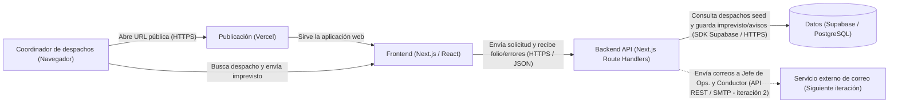

# Arquitectura y Camino Delgado · Gestión de imprevistos en despachos

---

## 1. Arquitectura de componentes

### Diagrama de componentes

> **Nota sobre la flecha punteada:** En el camino delgado actual (PoC), el backend guarda los registros de aviso en Supabase y devuelve su estado visible en pantalla sin llamar aún al servicio externo de correo. La integración real de envío de correos queda definida explícitamente para la siguiente iteración.

---

### Tabla de componentes

| Pieza | Qué hace en esta solución | Con qué está hecha | Con quién se comunica |
|---|---|---|---|
| **Frontend** | Muestra al Coordinador los despachos en curso (P1), el formulario para registrar un imprevisto seleccionando planta/despacho, tipo (`Carga no lista`, `Retraso` o `Camión en espera`) y descripción (P2), el aviso de campo faltante conservando lo escrito (P3), y la confirmación con folio y estado de avisos (P4). | Next.js (React), TypeScript y CSS con el sistema mínimo definido en `docs/prototipo.md`. | Con el **Coordinador** (navegador), con la **Publicación (Vercel)** que la sirve y con el **Backend API** vía HTTPS/JSON. |
| **Backend (API)** | Recibe el envío del formulario, valida que el despacho exista y que el tipo de imprevisto y la descripción sean obligatorios, asocia el registro al coordinador fijo de prueba (seed), guarda el imprevisto generando su folio y registra los avisos para Jefe de operaciones y Conductor. | Next.js Route Handlers (Node.js / TypeScript) ejecutándose en el mismo repositorio que el frontend. | Con el **Frontend** (recibe solicitudes y responde folio o errores de validación), con **Datos (Supabase)** y, en la siguiente iteración, con el **Servicio externo de correo**. |
| **Datos** | Almacena de forma persistente los 2–3 despachos semilla (`DESPACHOS`), el coordinador fijo de prueba (`USUARIOS`), los imprevistos registrados con su folio (`IMPREVISTOS`) y el registro de avisos asociados (`NOTIFICACIONES`). | Supabase (base de datos PostgreSQL administrada). | Exclusivamente con el **Backend (API)** mediante el SDK oficial de Supabase usando variables de entorno. |
| **Servicio externo *(siguiente iteración)*** | Envía por correo electrónico el aviso del imprevisto con folio, planta, despacho y tipo de cambio al Jefe de operaciones (HU-03) y al Conductor (HU-04), devolviendo confirmación de envío o error por destinatario (HU-05). | Proveedor de correo transaccional (ej. Resend o SMTP) integrado desde el Backend. | Recibe solicitudes del **Backend (API)** y entrega los correos a los destinatarios externos. |
| **Publicación** | Despliega automáticamente el Frontend y el Backend desde GitHub y expone una dirección web pública y repetible para que cualquier integrante o usuario de prueba abra la aplicación sin instalar nada local. | Vercel (conectado al repositorio de GitHub y con las variables de entorno de Supabase). | Con el **navegador del Coordinador** (sirve el Frontend y enruta las llamadas al Backend API). |

---

### Plan de falla del servicio externo

La solución depende del **servicio externo de correo** para notificar automáticamente al Jefe de operaciones y al Conductor (activado en la siguiente iteración), así como de la conectividad con **Supabase** para persistir el folio:

- **Si el servicio externo de correo no responde o rechaza un envío:**
  - **Qué ve la persona:** El imprevisto **sí queda guardado** en Supabase y la pantalla muestra igualmente el **folio generado**, pero junto al destinatario afectado aparece el estado **«Fallido»** (escenario **P4b · Envío fallido** de `docs/prototipo.md`) en vez de «Enviado».
  - **Qué hace mientras el servicio no responde:** Como ya cuenta con el folio y sabe exactamente a quién no le llegó el aviso, el Coordinador contacta directamente por teléfono o radio solo al destinatario marcado como «Fallido» usando el folio registrado, sin perder la trazabilidad ni tener que reingresar el imprevisto.
- **Si Supabase o la conexión a internet fallan al confirmar:**
  - **Qué ve la persona:** Un mensaje de alerta claro indicando que no fue posible guardar el imprevisto, manteniendo intactos los datos escritos en el formulario.
  - **Qué hace mientras no responde:** Puede reintentar el envío apenas vuelva la conexión sin reescribir el registro, o escalar el incidente manualmente por radio/teléfono si la urgencia operativa no permite esperar.

---

## 2. Camino delgado

### Acción elegida (una sola, de punta a punta)

**Registrar un imprevisto de un despacho en curso y devolver su folio visible junto al estado de los avisos** (flujo **P1 → P2 → [P3 si falta dato] → P4**):

1. **Pantalla de ingreso (Frontend):** El Coordinador abre la URL pública, selecciona uno de los **2–3 despachos de prueba (seed)** cargados en Supabase (P1), elige uno de los **3 tipos actuales de imprevisto** (**`Carga no lista`**, **`Retraso`** o **`Camión en espera`**), ingresa una breve descripción y presiona **Confirmar** (P2).
2. **Validación (Backend):** El endpoint de Next.js verifica que el despacho seleccionado exista y que **tipo de imprevisto** y **descripción** no vengan vacíos.
3. **Persistencia (Datos):** El backend inserta el registro en Supabase (`IMPREVISTOS`) vinculado al **coordinador fijo de prueba (seed)**, obtiene el **folio** generado y crea los registros de aviso para Jefe de operaciones y Conductor (`NOTIFICACIONES`).
4. **Respuesta visible (Frontend):** La pantalla **P4** muestra el **folio del imprevisto** y la lista de destinatarios con su estado visible, con la opción de volver a los despachos y repetir la acción.
5. **Publicación (Despliegue):** Todo el recorrido corre desplegado en una URL pública de **Vercel** (<https://grupo-4-sigma.vercel.app/>), repetible desde cualquier navegador.

### Inicio de sesión en esta etapa

En este camino delgado **no existe pantalla de login ni gestión de cuentas o permisos**. Al abrir la aplicación se ingresa directamente a la selección de despachos (P1), y todas las acciones de registro se asocian automáticamente a un **coordinador fijo de prueba (seed)** precargado en la tabla `USUARIOS` de Supabase (junto con los 2–3 despachos semilla en `DESPACHOS`). Esto permite probar el flujo real de punta a punta sin bloquear el avance por autenticación.

### Por qué corresponde al supuesto más frágil de la solución

El valor central de la aplicación (según la entrevista y las historias de usuario en `docs/historias.md`) es que un Coordinador de despachos pueda registrar un imprevisto en pocos segundos, obtener un **folio trazable** y saber quiénes quedan avisados, reduciendo la dependencia de llamadas y radio que hoy derivan en retrasos y multas por sobreestadía.

El supuesto más frágil es que **todo el circuito completo —desde el gesto de la persona en pantalla hasta la validación en backend, el guardado real en Supabase y la respuesta con folio visible en producción— funcione de manera simple, rápida y sin pérdida de datos**. Si este camino mínimo no funciona o resulta engorroso, agregar login, historial o integraciones externas sobre una base no probada solo añade complejidad sin validar la propuesta de valor.

### Qué queda fuera por ahora (decisión explícita, no olvido)

| Qué queda fuera | Razón / Cuándo entra |
|---|---|
| **Envío real de notificaciones por correo electrónico (HU-03 y HU-04)** | **Siguiente iteración.** En el camino delgado los avisos se guardan en Supabase y se muestran en P4 como registrados/simulados. Integrar el proveedor de correo externo y la detección real de fallos (P4b) se aborda una vez que el registro y folio punta a punta ya corren estables. |
| **Cuentas, claves, inicio de sesión y permisos por rol** | Se reemplaza temporalmente por un **coordinador fijo de prueba (seed)** en Supabase. La autenticación real se diseña cuando el camino base ya funciona desplegado. |
| **Editar, borrar o cerrar imprevistos, e historial consultable** | Llega al robustecer lo funcional, después de validar el alta de imprevistos con folio. |
| **Mantenedor de despachos y datos reales de producción** | En la PoC se usan **2–3 despachos semilla (seed)** precargados en Supabase para evitar construir pantallas administrativas antes de probar el flujo principal. |
| **Diseño visual terminado, modo sin conexión y otros canales (WhatsApp / app)** | Se utiliza el sistema mínimo funcional de `docs/prototipo.md`; pulido visual, soporte offline y canales adicionales quedan para etapas posteriores. |

### Qué ve la persona si algo falla

1. **Falta un campo obligatorio (tipo de imprevisto o descripción — P3):** El backend rechaza el envío y devuelve el detalle del campo faltante. La persona ve una alerta clara indicando qué dato falta, permanece en la pantalla de registro (P2/P3) y **conserva intacto lo que ya escribió** para corregir y volver a confirmar.
2. **Error de servidor o caída de conexión con Supabase:** La persona ve un mensaje visible de error indicando que el imprevisto no pudo registrarse, sin borrar los datos ingresados en el formulario, permitiéndole reintentar.
3. **Falla del servicio externo de correo (cuando se integre en la siguiente iteración — P4b):** La persona ve igualmente el **folio** del imprevisto guardado y la etiqueta **«Fallido»** junto al destinatario afectado, para poder contactarlo directamente por teléfono o radio.
