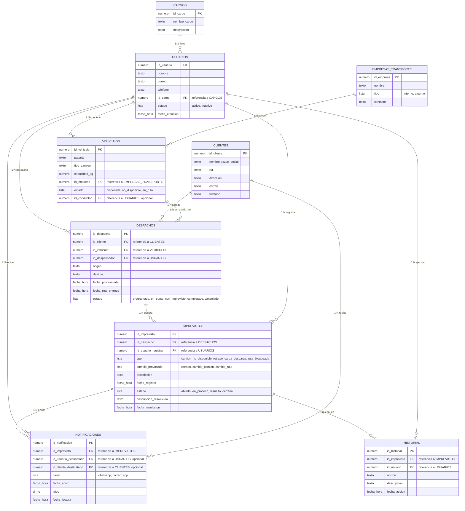

# Estructura de datos — Equipo 4

Este documento define las tablas de la base de datos a partir de los sustantivos
identificados en el caso de uso principal del Avance 2 (despachador, conductor,
jefe de operaciones, cliente, camión, despacho, imprevisto, notificación,
historial). Aún no se crea nada en Supabase; esto es solo el diseño.

---

## Parte 1 — Diagrama de la base de datos

**Tipos de campo usados:** `texto`, `numero`, `fecha_hora`, `si_no`, `lista`
(lista = el campo solo puede tomar uno de los valores indicados entre comillas).

**Notación:** `PK` = clave primaria, `FK` = clave foránea. En las relaciones,
`||` significa "exactamente uno" y `o{` significa "cero o muchos", por lo que
toda línea de abajo se lee como **1 : N** desde la tabla de la izquierda hacia
la de la derecha (y, en espejo, **N : 1** desde la derecha hacia la izquierda).
En este modelo no existe ninguna relación 1 : 1.

### Resumen de relaciones

| Tabla origen (1) | Tabla destino (N) | Cardinalidad | Significado |
|---|---|---|---|
| CARGOS | USUARIOS | 1 : N (N : 1 al revés) | Un cargo puede tener muchos usuarios; cada usuario tiene un solo cargo |
| USUARIOS (despachador) | DESPACHOS | 1 : N | Un despachador registra muchos despachos |
| USUARIOS (conductor) | VEHICULOS | 1 : N | Un conductor puede estar asociado a varios vehículos a lo largo del tiempo |
| EMPRESAS_TRANSPORTE | VEHICULOS | 1 : N | Una empresa de transporte posee varios camiones |
| CLIENTES | DESPACHOS | 1 : N | Un cliente puede tener muchos despachos |
| VEHICULOS | DESPACHOS | 1 : N | Un vehículo se usa en muchos despachos a lo largo del tiempo |
| DESPACHOS | IMPREVISTOS | 1 : N | Un despacho puede generar uno o varios imprevistos |
| USUARIOS (registra) | IMPREVISTOS | 1 : N | Un usuario puede registrar varios imprevistos |
| IMPREVISTOS | NOTIFICACIONES | 1 : N | Un imprevisto genera una o varias notificaciones (una por afectado) |
| USUARIOS (destinatario) | NOTIFICACIONES | 1 : N | Un usuario puede recibir muchas notificaciones |
| CLIENTES (destinatario) | NOTIFICACIONES | 1 : N | Un cliente puede recibir muchas notificaciones |
| IMPREVISTOS | HISTORIAL | 1 : N | Un imprevisto acumula varios eventos de historial |
| USUARIOS (ejecuta) | HISTORIAL | 1 : N | Un usuario puede ejecutar varias acciones registradas en el historial |

---

## Parte 2 — Campos obligatorios y ejemplos de registros

### CARGOS

**Obligatorios:** `id_cargo`, `nombre_cargo`

| id_cargo | nombre_cargo | descripcion |
|---|---|---|
| 1 | Despachador | Registra imprevistos en el despacho de camiones y comunica cambios |
| 2 | Conductor | Conduce el vehículo asignado y consulta el estado de sus rutas |

---

### USUARIOS

**Obligatorios:** `id_usuario`, `nombre`, `correo`, `id_cargo`, `estado`

| id_usuario | nombre | correo | telefono | id_cargo | estado | fecha_creacion |
|---|---|---|---|---|---|---|
| 1 | Pedro Soto | pedro.soto@grupo4.cl | +56912345678 | 1 (Despachador) | activo | 2026-03-01 08:00 |
| 2 | Carla Reyes | carla.reyes@grupo4.cl | +56987654321 | 2 (Conductor) | activo | 2026-03-02 09:15 |

---

### CLIENTES

**Obligatorios:** `id_cliente`, `nombre_razon_social`, `rut`, `correo`

| id_cliente | nombre_razon_social | rut | direccion | correo | telefono |
|---|---|---|---|---|---|
| 1 | Supermercados Lider S.A. | 76.123.456-7 | Av. Kennedy 5454, Las Condes | logistica@lider.cl | +56221234567 |
| 2 | Comercial Don Juan Ltda. | 77.987.654-3 | Camino a Melipilla 8200, Maipú | compras@donjuan.cl | +56229876543 |

---

### EMPRESAS_TRANSPORTE

**Obligatorios:** `id_empresa`, `nombre`, `tipo`

| id_empresa | nombre | tipo | contacto |
|---|---|---|---|
| 1 | Flota Propia Grupo 4 | interno | flota@grupo4.cl |
| 2 | Transportes Andina Ltda. | externo | contacto@andina.cl |

---

### VEHICULOS

**Obligatorios:** `id_vehiculo`, `patente`, `id_empresa`, `estado`

| id_vehiculo | patente | tipo_camion | capacidad_kg | id_empresa | estado | id_conductor |
|---|---|---|---|---|---|---|
| 1 | FXCV-21 | Rampla | 12000 | 1 (Flota Propia Grupo 4) | en_ruta | 2 (Carla Reyes) |
| 2 | HGKP-88 | Furgón | 3000 | 2 (Transportes Andina Ltda.) | disponible | *(vacío, sin conductor asignado)* |

---

### DESPACHOS

**Obligatorios:** `id_despacho`, `id_cliente`, `id_vehiculo`, `id_despachador`, `origen`, `destino`, `fecha_programada`, `estado`

| id_despacho | id_cliente | id_vehiculo | id_despachador | origen | destino | fecha_programada | fecha_real_entrega | estado |
|---|---|---|---|---|---|---|---|---|
| 1001 | 1 (Lider) | 1 (FXCV-21) | 1 (Pedro Soto) | CD Lo Espejo, Santiago | Supermercados Lider, Las Condes | 2026-03-10 09:00 | *(vacío)* | con_imprevisto |
| 1002 | 2 (Don Juan) | 2 (HGKP-88) | 1 (Pedro Soto) | CD Maipú, Santiago | Comercial Don Juan, Maipú | 2026-03-10 11:30 | 2026-03-10 12:05 | completado |

---

### IMPREVISTOS

**Obligatorios:** `id_imprevisto`, `id_despacho`, `id_usuario_registra`, `tipo`, `cambio_provocado`, `descripcion`, `fecha_registro`, `estado`

| id_imprevisto | id_despacho | id_usuario_registra | tipo | cambio_provocado | descripcion | fecha_registro | estado | descripcion_resolucion | fecha_resolucion |
|---|---|---|---|---|---|---|---|---|---|
| 5001 | 1001 | 1 (Pedro Soto) | ruta_bloqueada | cambio_ruta | Corte de Av. Kennedy por manifestación; se desvía por Américo Vespucio | 2026-03-10 09:40 | en_proceso | *(vacío)* | *(vacío)* |
| 5002 | 1002 | 1 (Pedro Soto) | retraso_carga_descarga | retraso | Demora de 35 minutos en descarga por falta de personal en bodega destino | 2026-03-10 11:45 | resuelto | Se reasignó personal de bodega y se completó la descarga | 2026-03-10 12:00 |

---

### NOTIFICACIONES

**Obligatorios:** `id_notificacion`, `id_imprevisto`, `canal`, `fecha_envio`, `leido`
(además, cada registro debe tener **al menos uno** de `id_usuario_destinatario` o `id_cliente_destinatario` lleno)

| id_notificacion | id_imprevisto | id_usuario_destinatario | id_cliente_destinatario | canal | fecha_envio | leido | fecha_lectura |
|---|---|---|---|---|---|---|---|
| 9001 | 5001 | 2 (Carla Reyes, conductora) | *(vacío)* | whatsapp | 2026-03-10 09:41 | si | 2026-03-10 09:50 |
| 9002 | 5001 | *(vacío)* | 1 (Supermercados Lider) | correo | 2026-03-10 09:42 | no | *(vacío)* |

---

### HISTORIAL

**Obligatorios:** `id_historial`, `id_imprevisto`, `accion`, `fecha_accion`

| id_historial | id_imprevisto | id_usuario | accion | descripcion | fecha_accion |
|---|---|---|---|---|---|
| 7001 | 5001 | 1 (Pedro Soto) | Registro de imprevisto | Se creó el caso por ruta bloqueada y se definió el desvío | 2026-03-10 09:40 |
| 7002 | 5002 | 1 (Pedro Soto) | Resolución de imprevisto | Se resolvió el retraso tras reasignar personal de bodega | 2026-03-10 12:00 |
