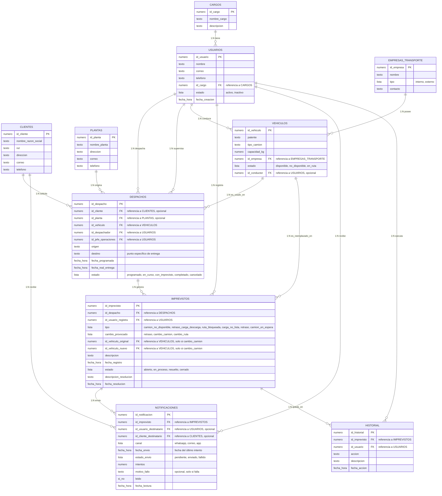

# Estructura de datos

Este documento define las tablas de la base de datos. Las tablas PLANTAS y los
campos marcados como nuevos se agregaron para calzar con el flujo descrito en
[docs/historias.md](../historias.md) (registrar un imprevisto en un despacho
minero en curso y avisar a los afectados). Los ejemplos de esta sección se
asocian al área minera (faenas, camiones de transporte de explosivos/mineral).

---

## Parte 1 — Diagrama de la base de datos

**Tipos de campo usados:** `texto`, `numero`, `fecha_hora`, `si_no`, `lista`
(lista = el campo solo puede tomar uno de los valores indicados entre comillas).

**Notación:** `PK` = clave primaria, `FK` = clave foránea. En las relaciones,
`||` significa "exactamente uno" y `o{` significa "cero o muchos", por lo que
toda línea de abajo se lee como **1 : N** desde la tabla de la izquierda hacia
la de la derecha (y, en espejo, **N : 1** desde la derecha hacia la izquierda).
En este modelo no existe ninguna relación 1 : 1.

### Resumen de relaciones

| Tabla origen (1) | Tabla destino (N) | Cardinalidad | Significado |
|---|---|---|---|
| CARGOS | USUARIOS | 1 : N (N : 1 al revés) | Un cargo puede tener muchos usuarios; cada usuario tiene un solo cargo |
| USUARIOS (despachador) | DESPACHOS | 1 : N | Un despachador registra muchos despachos |
| USUARIOS (jefe de operaciones) | DESPACHOS | 1 : N | Un jefe de operaciones supervisa muchos despachos; cada despacho tiene un jefe responsable, que es a quien se notifica (paso 4 del caso de uso) |
| USUARIOS (conductor) | VEHICULOS | 1 : N | Cada vehículo tiene a lo sumo un conductor asignado actualmente; un mismo conductor puede figurar como asignado en más de un vehículo. El modelo no guarda el historial de asignaciones |
| EMPRESAS_TRANSPORTE | VEHICULOS | 1 : N | Una empresa de transporte posee varios camiones |
| CLIENTES | DESPACHOS | 1 : N | Un cliente puede tener muchos despachos |
| PLANTAS | DESPACHOS | 1 : N | Una planta puede tener muchos despachos (HU-02: buscar el despacho por planta) |
| VEHICULOS | DESPACHOS | 1 : N | Un vehículo se usa en muchos despachos a lo largo del tiempo |
| DESPACHOS | IMPREVISTOS | 1 : N | Un despacho puede generar uno o varios imprevistos |
| USUARIOS (registra) | IMPREVISTOS | 1 : N | Un usuario puede registrar varios imprevistos |
| VEHICULOS (original / nuevo) | IMPREVISTOS | 1 : N | Cuando un imprevisto provoca un cambio de camión, guarda cuál era el vehículo original y cuál lo reemplaza; así `DESPACHOS.id_vehiculo` puede actualizarse sin perder el original |
| IMPREVISTOS | NOTIFICACIONES | 1 : N | Un imprevisto genera una o varias notificaciones (una por afectado) |
| USUARIOS (destinatario) | NOTIFICACIONES | 1 : N | Un usuario puede recibir muchas notificaciones |
| CLIENTES (destinatario) | NOTIFICACIONES | 1 : N | Un cliente puede recibir muchas notificaciones |
| IMPREVISTOS | HISTORIAL | 1 : N | Un imprevisto acumula varios eventos de historial |
| USUARIOS (ejecuta) | HISTORIAL | 1 : N | Un usuario puede ejecutar varias acciones registradas en el historial |

---

## Parte 2 — Campos obligatorios y ejemplos de registros

### CARGOS

**Obligatorios:** `id_cargo`, `nombre_cargo`

| id_cargo | nombre_cargo | descripcion |
|---|---|---|
| 1 | Despachador | Registra imprevistos en el despacho de camiones y comunica cambios |
| 2 | Conductor | Conduce el vehículo asignado y consulta el estado de sus rutas |
| 3 | Jefe de Operaciones | Recibe por correo el aviso del imprevisto para decidir qué hacer |

---

### USUARIOS

**Obligatorios:** `id_usuario`, `nombre`, `correo`, `id_cargo`, `estado`

| id_usuario | nombre | correo | telefono | id_cargo | estado | fecha_creacion |
|---|---|---|---|---|---|---|
| 1 | Pedro Soto | pedro.soto@solucion.cl | +56912345678 | 1 | activo | 2026-03-01 08:00 |
| 2 | Carla Reyes | carla.reyes@solucion.cl | +56987654321 | 2 | activo | 2026-03-02 09:15 |
| 3 | Marcela Fuentes | marcela.fuentes@solucion.cl | +56933221144 | 3 | activo | 2026-03-03 10:00 |

---

### CLIENTES

**Obligatorios:** `id_cliente`, `nombre_razon_social`, `rut`, `correo`

| id_cliente | nombre_razon_social | rut | direccion | correo | telefono |
|---|---|---|---|---|---|
| 1 | Supermercados Lider S.A. | 76.123.456-7 | Av. Kennedy 5454, Las Condes | logistica@lider.cl | +56221234567 |
| 2 | Matriceria Mac SpA| 77.987.654-3 | Camino a Melipilla 8200, Maipú | compras@mac.cl | +56229876543 |

---

### PLANTAS

**Obligatorios:** `id_planta`, `nombre_planta`, `direccion`

| id_planta | nombre_planta | direccion | correo | telefono |
|---|---|---|---|---|
| 1 | Faena Minera Los Bronces | Camino Internacional s/n, Los Andes | contacto@losbronces.cl | +56221112222 |
| 2 | Faena Minera Centinela | Ruta B-400 km 65, Sierra Gorda, Antofagasta | contacto@centinela.cl | +56552223344 |

---

### EMPRESAS_TRANSPORTE

**Obligatorios:** `id_empresa`, `nombre`, `tipo`

| id_empresa | nombre | tipo | contacto |
|---|---|---|---|
| 1 | Flota Propia | interno | flota@solucion.cl |
| 2 | Transportes Andina Ltda. | externo | contacto@andina.cl |
| 3 | Enaex S.A. | externo | contacto@enaex.com |

---

### VEHICULOS

**Obligatorios:** `id_vehiculo`, `patente`, `id_empresa`, `estado`

| id_vehiculo | patente | tipo_camion | capacidad_kg | id_empresa | estado | id_conductor |
|---|---|---|---|---|---|---|
| 1 | FXCV-21 | Rampla | 12000 | 1 | en_ruta | 2 |
| 2 | HGKP-88 | Furgón | 3000 | 2 | disponible | *(vacío, sin conductor asignado)* |
| 3 | FHTR-56 | Camión tolva de explosivos (ANFO) | 15000 | 3 | en_ruta | 2 |

---

### DESPACHOS

**Obligatorios:** `id_despacho`, `id_vehiculo`, `id_despachador`, `id_jefe_operaciones`, `origen`, `destino`, `fecha_programada`, `estado`
(cada registro debe tener **al menos uno** de `id_cliente` o `id_planta` lleno)

`id_vehiculo` es el camión **actual** del despacho; si un imprevisto provoca un cambio de camión, el original queda guardado en `IMPREVISTOS.id_vehiculo_original`.
`destino` es el punto específico de entrega (bodega, andén, polvorín), no el nombre del cliente, que ya está en CLIENTES.

| id_despacho | id_cliente | id_planta | id_vehiculo | id_despachador | id_jefe_operaciones | origen | destino | fecha_programada | fecha_real_entrega | estado |
|---|---|---|---|---|---|---|---|---|---|---|
| 1001 | 1 | *(vacío)* | 1 | 1 | 3 | CD Lo Espejo, Santiago | Andén 3, bodega de recepción | 2026-03-10 09:00 | *(vacío)* | con_imprevisto |
| 1002 | 2 | *(vacío)* | 2 | 1 | 3 | CD Maipú, Santiago | Tratamiento termicos Chile norte, Renca | 2026-03-10 11:30 | 2026-03-10 12:05 | completado |
| 1003 | *(vacío)* | 1 | 3 | 1 | 3 | Enaex S.A., planta Prillex América | Polvorín Faena Los Bronces | 2026-10-10 09:00 | *(vacío)* | con_imprevisto |
| 1004 | *(vacío)* | 2 | 1 | 1 | 3 | Faena Minera Centinela | Puerto Angamos, Mejillones | 2026-10-10 11:30 | 2026-10-10 12:05 | completado |

---

### IMPREVISTOS

**Obligatorios:** `id_imprevisto`, `id_despacho`, `id_usuario_registra`, `tipo`, `descripcion`, `fecha_registro`, `estado`
(`cambio_provocado` queda opcional cuando `tipo` ya es uno de los valores nuevos: carga_no_lista, retraso, camion_en_espera)
(`id_vehiculo_original` e `id_vehiculo_nuevo` se llenan **solo** cuando `cambio_provocado` = cambio_camion; en los demás casos quedan vacíos)

| id_imprevisto | id_despacho | id_usuario_registra | tipo | cambio_provocado | id_vehiculo_original | id_vehiculo_nuevo | descripcion | fecha_registro | estado | descripcion_resolucion | fecha_resolucion |
|---|---|---|---|---|---|---|---|---|---|---|---|
| 5001 | 1001 | 1 | ruta_bloqueada | cambio_ruta | *(vacío)* | *(vacío)* | Corte de Av. Kennedy por manifestación; se desvía por Américo Vespucio | 2026-03-10 09:40 | en_proceso | *(vacío)* | *(vacío)* |
| 5005 | 1002 | 1 | camion_no_disponible | cambio_camion | 1 | 2 | El camión FXCV-21 sigue retenido por el desvío del despacho 1001 y no alcanza a cargar; se asigna el HGKP-88 | 2026-03-10 11:10 | resuelto | Se reasignó el despacho al camión HGKP-88 | 2026-03-10 11:20 |
| 5002 | 1002 | 1 | retraso_carga_descarga | retraso | *(vacío)* | *(vacío)* | Demora de 35 minutos en descarga por falta de personal en bodega destino | 2026-03-10 11:45 | resuelto | Se reasignó personal de bodega y se completó la descarga | 2026-03-10 12:00 |
| 5003 | 1003 | 1 | camion_en_espera | *(vacío)* | *(vacío)* | *(vacío)* | Camión de Enaex queda en espera en el acceso al polvorín por protocolo de seguridad de manejo de explosivos | 2026-10-10 09:40 | en_proceso | *(vacío)* | *(vacío)* |
| 5004 | 1004 | 1 | carga_no_lista | *(vacío)* | *(vacío)* | *(vacío)* | La carga de concentrado de cobre no estaba lista para el retiro por demora en el pesaje en báscula de la faena | 2026-10-10 11:45 | resuelto | Se resolvió la demora de pesaje y se completó el retiro del concentrado | 2026-10-10 12:00 |

---

### NOTIFICACIONES

**Obligatorios:** `id_notificacion`, `id_imprevisto`, `canal`, `fecha_envio`, `estado_envio`, `intentos`, `leido`
(además, cada registro debe tener **al menos uno** de `id_usuario_destinatario` o `id_cliente_destinatario` lleno)

Extensión 2 del caso de uso: si un destinatario no puede ser notificado, el intento queda registrado con `estado_envio` = fallido, el número de `intentos` y el `motivo_fallo`. Mientras se reintenta, el estado es pendiente. `fecha_envio` guarda la fecha del último intento.

| id_notificacion | id_imprevisto | id_usuario_destinatario | id_cliente_destinatario | canal | fecha_envio | estado_envio | intentos | motivo_fallo | leido | fecha_lectura |
|---|---|---|---|---|---|---|---|---|---|---|
| 9001 | 5001 | 2 | *(vacío)* | whatsapp | 2026-03-10 09:41 | enviado | 1 | *(vacío)* | si | 2026-03-10 09:50 |
| 9002 | 5001 | *(vacío)* | 1 | correo | 2026-03-10 09:42 | enviado | 1 | *(vacío)* | no | *(vacío)* |
| 9003 | 5003 | 3 | *(vacío)* | correo | 2026-10-10 09:41 | enviado | 1 | *(vacío)* | si | 2026-10-10 09:50 |
| 9004 | 5004 | 2 | *(vacío)* | correo | 2026-10-10 11:48 | fallido | 2 | Casilla de correo no responde | no | *(vacío)* |

---

### HISTORIAL

**Obligatorios:** `id_historial`, `id_imprevisto`, `accion`, `fecha_accion`

| id_historial | id_imprevisto | id_usuario | accion | descripcion | fecha_accion |
|---|---|---|---|---|---|
| 7001 | 5001 | 1 | Registro de imprevisto | Se creó el caso por ruta bloqueada y se definió el desvío | 2026-03-10 09:40 |
| 7005 | 5005 | 1 | Cambio de camión | Se reemplazó el camión FXCV-21 (id 1) por el HGKP-88 (id 2) en el despacho 1002 | 2026-03-10 11:20 |
| 7002 | 5002 | 1 | Resolución de imprevisto | Se resolvió el retraso tras reasignar personal de bodega | 2026-03-10 12:00 |
| 7003 | 5003 | 1 | Registro de imprevisto | Se registró el camión de Enaex en espera en el polvorín por protocolo de seguridad | 2026-10-10 09:40 |
| 7004 | 5004 | 1 | Resolución de imprevisto | Se resolvió la demora de pesaje y se completó el retiro del concentrado de cobre | 2026-10-10 12:00 |
