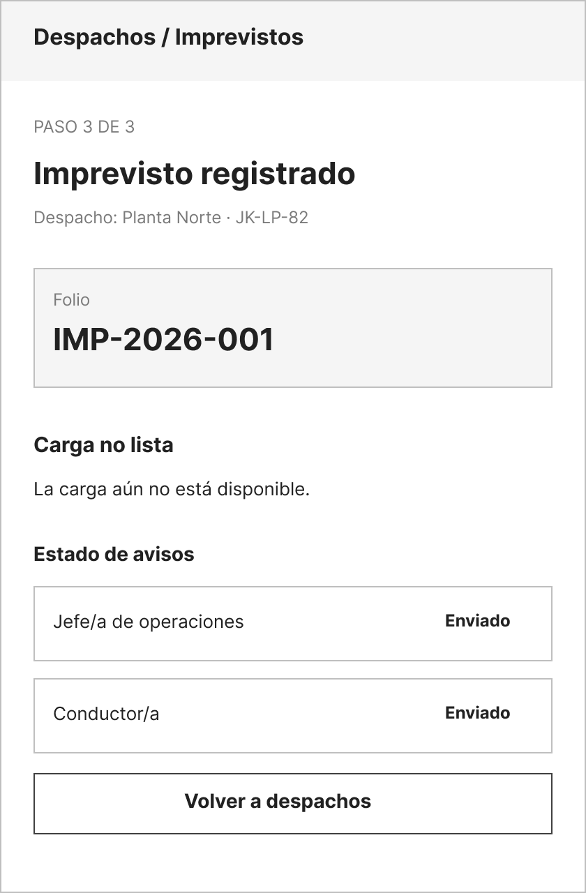
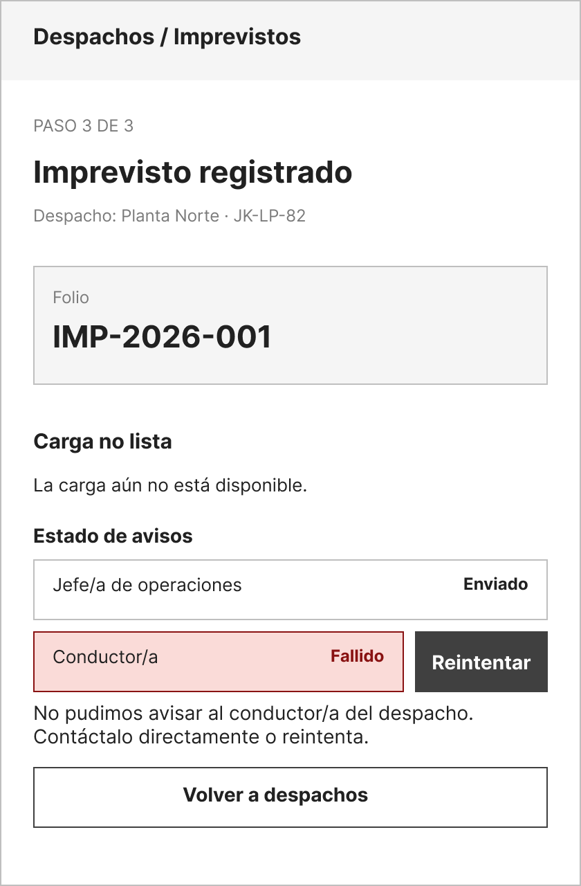

# Análisis ético del prototipo

## Mapa de impacto y exclusión (B1)

| Actor | Tarea que deja de hacer | Cómo se redefine su rol | Riesgo |
|---|---|---|---|
| Ejecuta: Coordinador/a de despachos | Llamar uno por uno a jefe y conductor | Registra el imprevisto y el sistema avisa por él | Si no registra a tiempo, nadie se entera |
| Decide/supervisa: Jefe/a de Operaciones | Monitorear cada despacho por radio | Revisa alertas por correo y decide si interviene | Si no revisa el correo, no interviene a tiempo |
| Excluido: Conductor/a sin cobertura en ruta, o con teléfono básico/antiguo sin apps de correo cómodas | Enterarse por radio en tiempo real | Depende de un correo que puede no llegarle o que no puede revisar bien desde su teléfono | Sigue una ruta desactualizada sin saberlo |

## Ficha de tratamiento de datos personales (B2)

| Campo | Dato personal | Finalidad (historia) | Quién accede | Conservación |
|---|---|---|---|---|
| Planta o patente (P1) | No | HU-02: ubicar el despacho | Coordinador/a | 12 meses desde el cierre del caso |
| Tipo de imprevisto (P2) | No | HU-01: clasificar el imprevisto | Coordinador/a, Jefe/a | 12 meses desde el cierre del caso |
| Descripción breve (P2) | No (texto libre) | HU-01: detallar qué pasó | Coordinador/a, Jefe/a, Conductor/a | 12 meses desde el cierre del caso |
| Nombre y correo del destinatario (P2, P4) | Sí | HU-03/HU-04: enviar el aviso a la persona correcta | Sistema (envío), Coordinador/a (ver estado) | En el aviso: 12 meses desde el cierre del caso. En la ficha del usuario: se eliminan 12 meses después de que la persona queda inactiva |

**Plazo propuesto por el equipo:** 12 meses permite comparar los imprevistos de un año
completo (temporadas, plantas y rutas que se repiten) sin guardar datos personales
indefinidamente. Cumplido el plazo, los datos personales del caso se eliminan; el
registro del imprevisto puede conservarse sin nombre ni correo (anonimizado) para
estadísticas. El plazo debe revisarse si la empresa usuaria tiene obligaciones de
auditoría más largas (por ejemplo, en el transporte de explosivos).

## Sesgo, accesibilidad y transparencia (B3)

- Contraste texto/fondo, **medido** con la fórmula de contraste de WCAG 2.2 (mínimo AA: 4,5:1 para texto normal; AAA: 7:1; 3:1 para bordes y elementos que no son texto). Los colores se tomaron de las capturas exportadas desde Figma (23-11-2026): el mensaje de error de P1 ([alerta-p1.png](capturas/alerta-p1.png)) y P4b ([p4b-envio-fallido.png](capturas/p4b-envio-fallido.png)):

  | Combinación | Razón de contraste | Resultado |
  |---|---|---|
  | Texto #212121 sobre fondo blanco #FFFFFF | 16,1 : 1 | Cumple AA y AAA |
  | Texto blanco #FFFFFF sobre botón #404040 («Reintentar») | 10,4 : 1 | Cumple AA y AAA |
  | Texto del mensaje de error #212121 sobre fondo rosado #FAC9C9 (P1) | 10,9 : 1 | Cumple AA y AAA |
  | Texto de la fila del aviso #212121 sobre fondo rosado #FADBD8 (P4b) | 12,4 : 1 | Cumple AA y AAA |
  | Texto rojo «Fallido» #891212 sobre fondo rosado #FADBD8 (P4b) | 7,5 : 1 | Cumple AA y AAA |
  | Borde rojo #891212 de la fila fallida sobre fondo blanco (P4b) | 9,7 : 1 | Cumple (mínimo 3:1) |

  El rojo #E91818 indicado en Figma no se usa como color de texto: el fondo #FAC9C9 del mensaje de error corresponde a ese rojo con baja opacidad (≈ 23 %) sobre blanco. Si se usara #E91818 directamente como texto, daría 4,6:1 sobre blanco (cumple AA, al límite) y 3,5:1 sobre el fondo rosado (no cumple), por lo que no debe usarse para texto.

- Elementos interactivos ≥ 24×24 px: **cumple**. Según la medición registrada en Figma ([nota-accesibilidad.png](capturas/nota-accesibilidad.png)), los botones miden 44 px de alto; el más pequeño, «Reintentar», mide 96 × 44 px, y los de ancho completo, 372 × 44 px.
- Estados expresados con texto, no solo color: cumple ("Enviado"/"Fallido" siempre llevan texto).
- Etiquetas visibles: cumple (cada campo tiene su etiqueta fija arriba).
- Priorización: no aplica, P1 no ordena los despachos por ningún criterio.
- Inteligencia artificial: no aplica, ninguna pantalla usa sugerencias de IA.

## Sostenibilidad y riesgos (B4)

Prácticas: comprimir las imágenes antes de subirlas al repositorio · consultar
solo los despachos en curso en P1, no el historial completo · desactivar el
enlace de Figma/Vercel de versiones anteriores.

| Riesgo | Tratamiento | Responsable | Cuándo se revisa |
|---|---|---|---|
| El correo de aviso no llega | Mitigar: mostrar "Fallido" y permitir reintentar | Marcelo | Al implementar el envío real |
| El conductor no tiene cobertura y no recibe el aviso | Aceptar por ahora, documentado como limitación | Diego | Al definir un canal alternativo |
| La descripción libre incluye datos de terceros | Mitigar: agregar texto de ayuda en el campo | Macarena | Al definir validaciones del formulario |
| Datos de ejemplo quedan públicos en Figma/Vercel | Evitar: usar siempre datos ficticios | Alberto | Antes de cada entrega |

## Integración

La modificación es la pantalla **P4b (envío fallido)**: nace del hallazgo B1
(el conductor sin cobertura queda excluido si el aviso falla y nadie lo
nota), y le da una alternativa visible (estado "Fallido" + reintentar) en
vez de asumir que el aviso siempre llega.

- Antes: 
- Después: 

**Estado según la retroalimentación (22-11-2026):** P4b no existía en el
prototipo de Figma. **Actualización (23-11-2026):** P4b ya está creada en Figma,
con el estado "Fallido" junto al destinatario, el mensaje «No pudimos avisar al
conductor/a del despacho. Contáctalo directamente o reintenta.» y el botón
"Reintentar". Su captura quedó como "Después".
