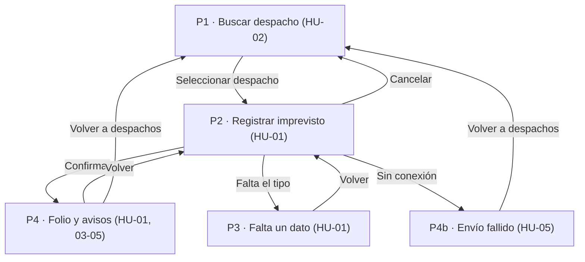

# Prototipo navegable · Gestión de imprevistos en despachos mineros

Enlace: https://www.figma.com/design/bEA6Z4q13xJlCxUTl2BNZg/Entrega-4?node-id=41-339&p=f

## Sistema mínimo (A2)

Texto: 20 px (títulos) y 14 px (contenido) · Acción: gris oscuro #333333 ·
Alerta: rojo sobre fondo rosado #FADBD8 · Espaciado: 8 px

## Mapa de navegación (A3)

Caminos alternativos: 1) falta el tipo de imprevisto (P2 → P3 → P2, criterio
del Avance 4) 2) sin conexión / envío fallido (P2 → P4b)

## Registro de decisiones (A5)

| Pantalla | Historia | Criterio que verifica | Simulado | Funcional |
|---|---|---|---|---|
| P1 · Buscar despacho | HU-02 | Se elige un despacho en curso antes de registrar | Lista de despachos de ejemplo | Búsqueda, selección, navegación a P2 |
| P2 · Registrar imprevisto | HU-01 | Tipo y descripción obligatorios | Envío real de la notificación | Validación del tipo, Confirmar, Volver, Cancelar |
| P3 · Falta un dato | HU-01 (alternativo) | Se indica el campo faltante sin perder los datos | — | Mensaje de error, descripción se conserva, Volver |
| P4 · Folio y avisos | HU-01, 03-05 | Folio visible y estado de cada aviso | Folio y estado de envío | Volver, Volver a despachos |
| P4b · Envío fallido | HU-05 (alternativo) | Estado "Fallido" visible junto al destinatario | Folio y estado de envío | Volver a despachos |
