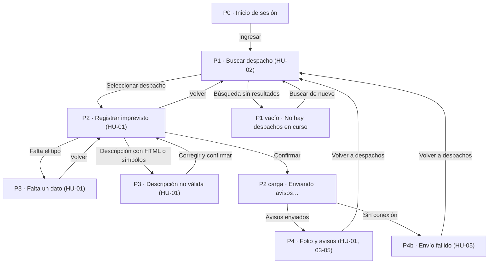

# Prototipo navegable · Gestión de imprevistos en despachos mineros

Enlace: https://www.figma.com/file/LsDxkm3a9WNEiHiWuEvOw0?node-id=41:339&locale=en&type=design

## Sistema mínimo (A2)

Texto: 20 px (títulos) y 14 px (contenido), color #212121 · Acción: gris oscuro
#404040, botones de 44 px de alto · Alerta: fondo rosado #FAC9C9 (mensaje de
error) o #FADBD8 (fila de aviso fallido), estado «Fallido» y borde en rojo
#891212 · Espaciado: 8 px

## Mapa de navegación (A3)

Caminos alternativos: 1) falta el tipo de imprevisto (P2 → P3 → P2, criterio
del Avance 4) 2) sin conexión / envío fallido (P2 → P2 carga → P4b)
3) descripción con HTML o símbolos no permitidos (P2 → P3 descripción no válida
→ P2; captura en [p3-descripcion-no-valida.png](capturas/p3-descripcion-no-valida.png))

**Corrección según la retroalimentación (22-11-2026):**
- El mapa decía que P2 tenía «Cancelar», pero en la pantalla solo existe
  «Volver», que lleva a P1. Se corrigió el mapa para que coincida con la pantalla.
- Se agregaron dos estados que faltaban: **P1 vacío** (la búsqueda no encuentra
  despachos en curso en esa planta: «No hay despachos en curso en esta planta»)
  y **P2 carga** (al tocar Confirmar: «Enviando avisos…», con el botón
  desactivado para no enviar dos veces).
- **Actualización (23-11-2026): P1 vacío, P2 carga y P4b ya están creadas en
  Figma.** Capturas en [docs/capturas/](capturas/):
  [p1-vacio.jpg](capturas/p1-vacio.jpg), [p2-carga.jpg](capturas/p2-carga.jpg) y
  [p4b-envio-fallido.png](capturas/p4b-envio-fallido.png). En la misma carpeta
  están las pantallas principales: [P1](capturas/p1-lista-despachos.jpg) y
  [P4](capturas/p4-folio-y-avisos.png).
- Al hacer clic en «Seleccionar despacho» el prototipo no avanzaba.
  **Actualización (23-11-2026):** los botones ya están conectados y el recorrido
  avanza al hacer clic en el modo de presentación de Figma. Pendiente: probar el
  enlace en una ventana de incógnito para confirmar que abre sin iniciar sesión.
- **P0 · Inicio de sesión** es la pantalla con la que comienza la app en el
  prototipo ([p0-inicio-sesion.jpg](capturas/p0-inicio-sesion.jpg)). La PoC
  publicada no la incluye: en el camino delgado no hay login y todas las
  acciones se asocian a un coordinador fijo de prueba (ver
  [arquitectura.md](arquitectura.md), «Inicio de sesión en esta etapa»).
- **Se quitó «← Volver» de P4 y P4b (23-11-2026).** En la prueba de la PoC en
  Vercel se detectó que ese botón regresaba a P2 con los datos aún escritos y, al
  confirmar de nuevo, se guardaba un imprevisto duplicado con otro folio. La PoC
  lo quitó (commit `29b1e9e`, ver [arquitectura.md](arquitectura.md), «Qué ve la
  persona si algo falla», punto 4) y el prototipo se ajusta para coincidir: desde
  P4 y P4b solo se sale con «Volver a despachos», que limpia el formulario y
  vuelve a P1.

## Registro de decisiones (A5)

| Pantalla | Historia | Criterio que verifica | Simulado | Funcional |
|---|---|---|---|---|
| P0 · Inicio de sesión | — (sin historia de usuario) | Solo una cuenta de despachador entra a la app | Validación de usuario y clave, recuperar contraseña | Ingresar, navegación a P1 |
| P1 · Buscar despacho | HU-02 | Se elige un despacho en curso antes de registrar | Lista de despachos de ejemplo | Búsqueda, selección, navegación a P2 |
| P1 vacío | HU-02 (estado vacío) | Si la búsqueda no encuentra nada, se dice por qué y no queda una lista en blanco | Resultado de búsqueda vacío | Mensaje «No hay despachos en curso en esta planta», Buscar de nuevo |
| P2 · Registrar imprevisto | HU-01 | Tipo y descripción obligatorios | Envío real de la notificación | Validación del tipo, Confirmar, Volver |
| P2 carga | HU-01 (estado de carga) | Al confirmar, la persona ve que el envío está en curso | Tiempo de envío | Aviso «Enviando avisos…», botón Confirmar desactivado |
| P3 · Falta un dato | HU-01 (alternativo) | Se indica el campo faltante sin perder los datos | — | Mensaje de error, descripción se conserva, Volver |
| P3 · Descripción no válida | HU-01 (alternativo) | Se rechaza la descripción con HTML o símbolos no permitidos, sin perder lo escrito | — | Campo marcado en rojo, mensaje «La descripción solo puede contener texto, números y signos de puntuación básicos», Volver, Confirmar |
| P4 · Folio y avisos | HU-01, 03-05 | Folio visible y estado de cada aviso | Folio y estado de envío | Volver a despachos |
| P4b · Envío fallido | HU-05 (alternativo) | Estado "Fallido" visible junto al destinatario | Folio y estado de envío | Reintentar, Volver a despachos |
