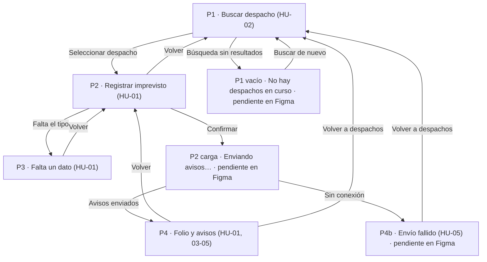

# Prototipo navegable · Gestión de imprevistos en despachos mineros

Enlace: https://www.figma.com/design/bEA6Z4q13xJlCxUTl2BNZg/Entrega-4?node-id=41-339&p=f

## Sistema mínimo (A2)

Texto: 20 px (títulos) y 14 px (contenido) · Acción: gris oscuro #333333 ·
Alerta: rojo sobre fondo rosado #FADBD8 · Espaciado: 8 px

## Mapa de navegación (A3)

Caminos alternativos: 1) falta el tipo de imprevisto (P2 → P3 → P2, criterio
del Avance 4) 2) sin conexión / envío fallido (P2 → P2 carga → P4b)

**Corrección según la retroalimentación (22-11-2026):**
- El mapa decía que P2 tenía «Cancelar», pero en la pantalla solo existe
  «Volver», que lleva a P1. Se corrigió el mapa para que coincida con la pantalla.
- Se agregaron dos estados que faltaban: **P1 vacío** (la búsqueda no encuentra
  despachos en curso en esa planta: «No hay despachos en curso en esta planta»)
  y **P2 carga** (al tocar Confirmar: «Enviando avisos…», con el botón
  desactivado para no enviar dos veces).
- **P1 vacío, P2 carga y P4b están en el mapa, pero todavía no en Figma.** Quedan
  pendientes de crear en el prototipo antes de ejecutar la prueba con usuarios.
- Pendiente en Figma: revisar que los botones estén conectados (al hacer clic en
  «Seleccionar despacho» el prototipo no avanzaba) y probar el enlace en una
  ventana de incógnito.

## Registro de decisiones (A5)

| Pantalla | Historia | Criterio que verifica | Simulado | Funcional |
|---|---|---|---|---|
| P1 · Buscar despacho | HU-02 | Se elige un despacho en curso antes de registrar | Lista de despachos de ejemplo | Búsqueda, selección, navegación a P2 |
| P1 vacío *(pendiente en Figma)* | HU-02 (estado vacío) | Si la búsqueda no encuentra nada, se dice por qué y no queda una lista en blanco | Resultado de búsqueda vacío | Mensaje «No hay despachos en curso en esta planta», Buscar de nuevo |
| P2 · Registrar imprevisto | HU-01 | Tipo y descripción obligatorios | Envío real de la notificación | Validación del tipo, Confirmar, Volver |
| P2 carga *(pendiente en Figma)* | HU-01 (estado de carga) | Al confirmar, la persona ve que el envío está en curso | Tiempo de envío | Aviso «Enviando avisos…», botón Confirmar desactivado |
| P3 · Falta un dato | HU-01 (alternativo) | Se indica el campo faltante sin perder los datos | — | Mensaje de error, descripción se conserva, Volver |
| P4 · Folio y avisos | HU-01, 03-05 | Folio visible y estado de cada aviso | Folio y estado de envío | Volver, Volver a despachos |
| P4b · Envío fallido *(pendiente en Figma)* | HU-05 (alternativo) | Estado "Fallido" visible junto al destinatario | Folio y estado de envío | Reintentar, Volver a despachos |
